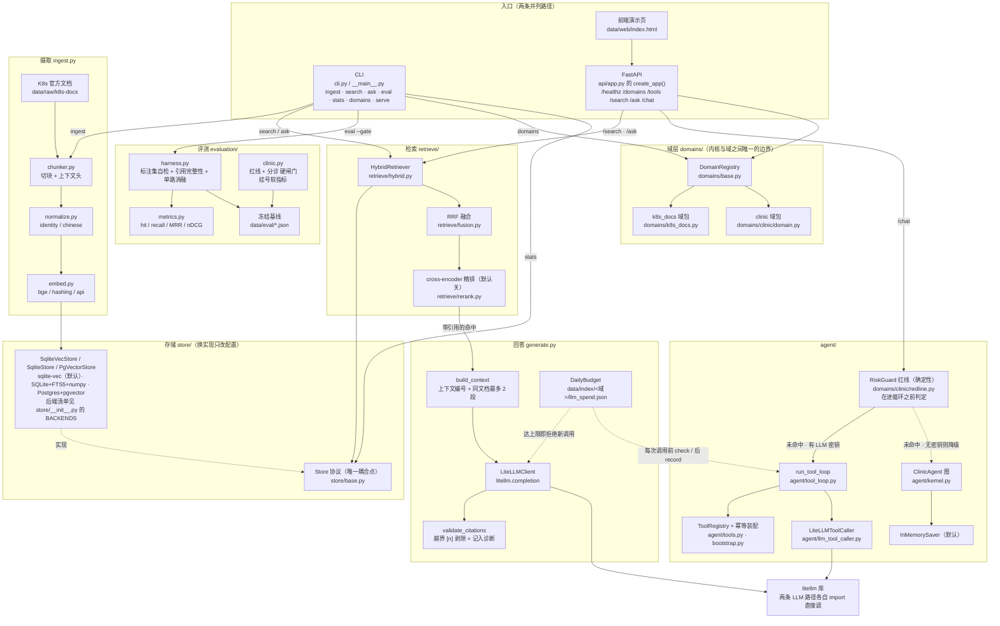

# kubedocs

> 面向**两个域**的检索问答与 Agent 平台：`k8s_docs`（Kubernetes 官方文档，英文）与
> `clinic`（医疗问诊 / 挂号 / 紧急，中文）。
> 检索走混合召回（BM25 + 向量）+ RRF 融合 + 可选重排，回答**必须带可点击引用**，查不到就明说。
> **本机零容器即可跑通全链路**。

这是一个**工业级工程作品**（非研究原型）：重点不在"我实现了一个算法"，而在
**选型判断、可观测、评测驱动、成本与延迟约束、失败模式设计**。

```bash
python -m kubedocs.cli domains          # 列出可用域
python -m kubedocs.cli stats --verify   # 索引体检
python -m kubedocs.cli --hf-offline eval --gate   # 评测并卡闸门
```

**双域是刻意的**：内核（图、工具协议、状态、评测）与域（语料、语言、能力）解耦，
一份内核跑两个完全不同的域。设计记录见 [`docs/adr/0003-双域agent平台.md`](docs/adr/0003-双域agent平台.md)。

---

## 状态（诚实标注）

| 部分 | 状态 |
|---|---|
| 语料获取（1720 篇官方 markdown / 16.2 MB） | ✅ 已验证 |
| 切块器 + 真实语料体检 | ✅ 已验证（见「实测数字」） |
| 本地索引：SQLite + FTS5 + `sqlite-vec`（默认后端） | ✅ 已验证（含 FTS 一致性自检） |
| 增量/幂等摄取（文档级 + 块级跳过） | ✅ 已验证（幂等复跑 0 变更 / 1.6 秒） |
| 混合检索 + RRF 融合 + 单路消融 | ✅ 已验证（hybrid hit@10 = **0.84**） |
| 带引用回答 + 拒答 + 预算上限 | ✅ 已验证（含真实 LLM 端到端；**日上限现在覆盖 `/ask` 与 `/chat` 两条路径**） |
| 金标集（50 条）+ 指标 + 闸门 | ✅ 已验证（标注集自检 + 闸门能红） |
| **P0 双域地基**：域协议 / 多域索引 / 中文归一化 | ✅ 已完成（k8s 域指标零回归） |
| P1 医疗域资产迁移 | ✅ 已完成（三维门控 / 急诊红线 `domains/clinic/redline.py` / 号源库 `booking.py` · `sqlite_provider.py` / 知识卡片脚本 `scripts/clinic_build_cards.py`） |
| P2 agent 内核（图 / 工具 / 持久化 / 中断） | ✅ 已完成（`agent/` 13 个模块：LangGraph `StateGraph` + 工具循环 + `InMemorySaver` + `interrupt` 续跑；单测在闸门内） |
| P5 FastAPI + 对话前端 | ✅ 已完成（`api/app.py` 6 个 API 端点 + `data/web/index.html` + `scripts/smoke_api.py` 冒烟） |
| `docker compose up` 全栈 | ⚠️ **文件已写，本机 Docker Hub 不可达，未实测** |

> 本项目坚持一件事：**没跑过的就不写"已完成"**。

---

## 为什么做这个（以及它和"从零手写"路线的区别）

我此前的项目（医疗预问诊 Agent）把检索、网关、认证、评测都自己写了一遍。那个项目适合讲
**领域深耕**（中文临床语境判定没有现成实现，只能自研）。但工业场景里更重要的判断是
**"什么该用成熟件、什么必须自研"**：

| 部件 | 本项目选择 | 理由 |
|---|---|---|
| 全文检索 | **SQLite FTS5**（带 `bm25()` 排序 + 列权重） | 标准库自带、零运维；能力与"用 Postgres 全文检索"等价 |
| 向量检索 | **sqlite-vec**（默认；`sqlite`+numpy 与 `pgvector` 也在同一协议下） | 同一 `Store` 协议下换实现只改配置（`KUBEDOCS_STORE`）。vec0 换来的是"向量与块行同事务、可增删、不常驻内存"，**不是延迟**——它比 numpy 暴力内积慢约 11 倍（实测见 [`docs/adr/0004-向量存储后端.md`](docs/adr/0004-向量存储后端.md)） |
| 多路融合 | **RRF**（自实现，约 20 行） | 免标定、跨语料稳定，与 OpenSearch 内置策略同源 |
| 嵌入 | 本地 BGE-small-en（可切 API） | 医疗/企业语料常不允许出境；本地可离线复现，CI 不吃密钥 |
| 评测 | **自建金标闸门 + 标注集自检** | 闸门纪律（能失败、拒绝跨集比较、基线溯源）是框架给不了的 |
| LLM 网关 | **LiteLLM**（两条 LLM 路径各自直接调这个库，不共用同一个客户端类） | 多供应商路由/重试/回退/成本统计，自研是重复劳动 |
| Agent 编排 | **LangGraph**（`agent/kernel.py` 的图 + `interrupt` 中断续跑） | 耐久状态 + 中断恢复，不必自己写状态机与持久化 |

**存储为什么先是 SQLite 而不是 pgvector**：把"业务逻辑跑通"与"一键可复现部署"
拆成两个目标后，先做前者。判断依据、代价与边界写在
[`docs/adr/0002-先跑通业务逻辑.md`](docs/adr/0002-先跑通业务逻辑.md)；
完整选型记录见 [`docs/adr/`](docs/adr/)。

---

## 架构

下面这张图是**按 `src/kubedocs/` 的实际文件画的组件与数据流**（每个框都对应真实模块，
不是设想的架构）；再下面的示意图讲的是"本机形态 vs 生产形态"的取舍。



图里三处容易看图看错的地方，在这里说明白（都与上面的「状态（诚实标注）」一致）：

- `Store` 协议**不止一个实现**：`sqlite-vec`（默认，`store/sqlite_vec_store.py`）、
  `sqlite`（`store/sqlite_store.py`，SQLite + FTS5 + numpy 向量）、`pgvector`
  （`store/pgvector_store.py`，Postgres）都在，后端名以 `store/__init__.py` 的
  `BACKENDS` 与 `config.py` 的 `store` 字段为单一出口（默认值 `"sqlite-vec"`）。
  图里只画一个存储框，是为了突出"换实现只改配置"这条唯一耦合点，**不是"只有一个实现"**。
- **两条 LLM 路径共用的是 `litellm` 这个库，不是同一个客户端类**：`generate.py` 里的
  `LiteLLMClient` 走 `litellm.completion`；`agent/llm_tool_caller.py`
  则是自成一体的 `LiteLLMToolCaller`，自己 `import litellm`
  直接调用，**全文不 import `LiteLLMClient`**。所以图里两条边分别指向 litellm 库。
  但**日预算**是**同一本账**：`generate.DailyBudget` 既挂在 `generate.py` 这条边上，
  也被 `run_tool_loop(..., budget=...)` 在**每次模型调用之前**检查
  （图里两条虚线都指向 `BUD`）。这一点**曾经是缺陷**：预算原先只挂在
  `generate.py` 这条边上，`/chat` 的工具循环不走它、成本只被累加进一个随对象丢弃的
  `self.cost` ⇒ `/chat` 没有日上限。修复记录（含"算不出价不许按 0 记"与跨进程边界）
  见 `SECURITY.md` 的 S-2。
- `/chat` 有两条路径：有密钥走工具循环（模型决定控制流），无密钥降级到确定性图；
  红线在两条路径里都是**进循环之前**的确定性判定。
  `thread_id` 的**属主绑定**（首见即绑定 `patient_id`，换属主 ⇒ 409）与
  **LRU 上界**也在这一层（`api/threads.py`，见 `SECURITY.md` 的 S-3）。

```
   本机（当前，零外部依赖）                             生产形态（同一套业务代码）
   ─────────────────────────────                        ─────────────────────────
    CLI / FastAPI                                        api (FastAPI) ─▶ agent (LangGraph)
        │                                                     │
        ▼                                                     ▼
   ingest: 语料 ─▶ 切块 ─▶ BGE 嵌入 ─▶ 索引            LiteLLM ─▶ LLM 供应商
        │                                                     │
        ▼                                                     ▼
   ┌──────────────────────────────┐                  ┌───────────────────────┐
   │ Store 协议（唯一耦合点）     │  ← 换实现只需改配置 →  │ Postgres + pgvector │
   │ · SQLite FTS5（bm25 排序）   │                  │ · 同一 Store 协议     │
   │ · sqlite-vec 向量索引（余弦）│                  └───────────────────────┘
   └──────────────────────────────┘
        │
        ▼
   retrieve: 两路并行召回 ─▶ RRF 融合 ─▶（可选）cross-encoder 精排 ─▶ 引用组装
        │
        ▼
   eval: 标注集自检 ─▶ 指标(hit/recall/MRR/nDCG) ─▶ 单路消融 ─▶ 基线闸门
```

**检索链路**：`query → 两路并行召回(FTS5 + 向量) → RRF 融合 → 重排(可选) → 结果带引用`
每一段都有耗时与降级诊断（`search --explain` / `--json` 可见）。

**回答链路**：`检索 → 编号组装上下文 → LLM → 引用核对 → 带引用回答 或 拒答`

回答层的三条硬规则（都有单测）：

1. **只依据检索到的片段回答**，每个论断带 `[n]` 引用，与来源编号一一对应；
2. **检索为空就不调用 LLM**，直接拒答——既省成本，也不给模型"凭空作答"的机会。
   这条是可断言的（单测直接断言打桩 LLM **一次都没被调用**）；
3. **引用标记必须可核对**：`[n]` 只能指向真实提供的那 n 段片段；模型编出 `[99]`
   会被剥掉并记入诊断。**指向不存在来源的引用，比没有引用更有误导性。**
   回答里一个引用都没有，同样会被标记出来。

另外两条工程约束：系统提示明确要求**标识符逐字保留**（参数名/字段名/命令/错误码
不得翻译或缩写——对技术文档问答来说改写标识符等于答错）；LLM 花费按日累计落盘，
**到达上限即拒绝新调用**，而不是悄悄烧钱。

---

## 快速开始（本机，无需 Docker）

```bash
python -m venv --system-site-packages .venv
. .venv/bin/activate                  # Windows: .venv\Scripts\activate
pip install -e ".[dev]"

# 1) 拉语料（一次就够，1720 篇 / 16.2 MB）
python scripts/fetch_corpus.py

# 2) 建索引（增量；首次全量约 35 分钟，其中嵌入占绝大部分）
python -m kubedocs.cli --hf-endpoint https://hf-mirror.com ingest

# 3) 检索
python -m kubedocs.cli search "how do I stop a container using too much memory" --explain

# 4) 带引用回答（需要 LLM 密钥；没有密钥时只返回检索结果 + 明确原因，不会崩）
python -m kubedocs.cli ask "怎么限制一个 Pod 的 CPU？" --show-context

# 5) 索引体检（含 FTS 一致性自检）
python -m kubedocs.cli stats --verify

# 6) 评测：先预检标注集，再评测并卡闸门
python scripts/check_gold.py
python -m kubedocs.cli eval --write-baseline      # 首次冻结基线
python -m kubedocs.cli eval --gate                # 之后每次回归检查
```

不想下载模型（离线/受限网络）时，用确定性哈希向量跑通管道：

```bash
python -m kubedocs.cli --provider hashing ingest --limit-files 100
```

> `hashing` 只擅长字面重合，**不能用于任何质量结论**；它存在的意义是让管道可离线自测。

退出码约定（供脚本与 CI 判断，不必解析 stdout）：
`0` 成功 ／ `1` 参数错误 ／ `2` 闸门不通过 ／ `3` 索引为空、标注集不合法等前置条件不满足。

---

## 实测数字

### 语料与切块（`python scripts/chunk_stats.py`，1720 篇官方文档）

| 项 | 值 |
|---|---|
| 文件 / 体积 | 1720 篇 markdown / 16.2 MB（与 GitHub 树接口预测**完全一致**） |
| 块数 | 18861 |
| 块长 中位 / p95 | 764 / 1621 字符 |
| 含代码块的块 | 16.3% |
| 非法引用 URL | **0** |
| 内容逐字重复块 | **1.12%**（见下） |
| 切块吞吐 | ~1085 文件/s |

**体检驱动的三次修正**（都在真实语料上量化过）：

| 问题 | 修法 | 效果 |
|---|---|---|
| API reference 的 HTML 表格原样入库（占语料 59%） | `strip_html`：剥标记留文字、表格转可读行、**不碰代码围栏** | p95 块长 2125 → 1540 |
| 重叠按字符硬切，产生 `...rip between` 这类半截块 | 重叠对齐到词/行边界，对不齐就放弃重叠 | 消除词中断块 |
| 模板化小节跨文档同形 → **30.7% 逐字重复块** | 块首加「文档标题 › 面包屑」上下文头 | 重复 **30.7% → 1.12%** |

### 嵌入吞吐（决定全量摄取时长，i7-13700H / 14 核 / 纯 CPU torch 2.11）

| 项 | 值 |
|---|---|
| 模型 | BAAI/bge-small-en-v1.5（384 维，max_seq 512） |
| 吞吐（真实块，中位 195 token） | **约 9.4 块/s ≈ 1900 token/s** |
| 长度分桶（按长度排序后编码） | **无收益**（59.5s → 58.9s）——瓶颈不是 padding |
| 线程数 4 / 8 / 14 | 5.3 / 9.2 / 9.1 块/s（≥8 线程即饱和） |
| batch 32 / 64 / 128 / 256 | 9.3 / 9.4 / 8.1 / 6.9 块/s（**批越大越慢**） |

⇒ 一次全量摄取≈35 分钟，**嵌入是整条链路的成本瓶颈**。这些负面结论同样有价值：
它们排除了"调 batch/分桶就能加速"的假设，说明下一步该做的是量化/ONNX，
而不是继续调参。超长块（>512 token）会被静默截断，摄取时会明确计数并打印。

### 全量索引（`python -m kubedocs.cli ingest`，真实 bge-small-en）

| 项 | 值 |
|---|---|
| 扫描 / 变更 / 未变 | 1720 / 1680 / 40（40 是冒烟跑已建的） |
| 写入块数 | 18308（索引合计 **18861**，与切块器预测**逐块一致**） |
| 编码 / 复用向量 | 18096 / 179（复用来自跨篇同内容块） |
| 空文档 | 64 |
| **超长被截断** | **480 块（2.5%）** —— 尾部内容在向量路上检索不到，但全文路仍可命中 |
| 总耗时 | 2062s（34.4 分钟） |
| FTS 一致性自检 | ok |

### 检索质量与延迟（50 条标注，`eval`，`top_k=10`）

| 模式 | hit@10 | recall | MRR | nDCG | p50 | p95 |
|---|---|---|---|---|---|---|
| **hybrid（FTS5+向量+RRF）** | **0.84** | 0.76 | **0.5205** | 0.5464 | **61 ms** | **76 ms** |
| dense-only | 0.78 | 0.71 | 0.4253 | 0.4759 | 43 ms | 46 ms |
| bm25-only | 0.70 | 0.63 | 0.3787 | 0.4357 | 19 ms | 35 ms |

> 延迟是在 P0 里**顺带修掉一个一直存在的缺陷**之后的数字：`keyword_search` 原先在 FTS 上
> 直接 `JOIN chunks` 取 `chunk_id`，导致执行计划变成"把 9000 多行命中全连上再排序"。
> 实测分解：纯 MATCH 0.04ms → 加 `ORDER BY bm25` 6.6ms → **加 JOIN 57.5ms**。
> 改为两步取（先取前 N 个 rowid，再按 rowid 查 `chunk_id`）后 hybrid p50 163→61ms、
> p95 245→76ms（相对最初基线 2.1× / 2.4×），**且检索指标逐位不变**。
> 详见 [ADR-0003 第六节](docs/adr/0003-双域agent平台.md)。

按问题类型（hybrid）：

| 类型 | 条数 | hit@10 | MRR |
|---|---|---|---|
| identifier（`topologySpreadConstraints`、`--eviction-hard` …） | 15 | **1.0000** | 0.5767 |
| paraphrase（"容器吃内存太多怎么办"） | 15 | 0.8000 | 0.4951 |
| concept（"一个 Pod 会经历哪些阶段"） | 20 | 0.7500 | 0.4975 |

**混合检索确实有效**：比最好的单路（向量）高 6pp，比全文路高 14pp。分类型看原因很清楚——
向量路在 paraphrase 上明显更强（0.47 vs 全文 0.60 反过来），而两者融合后 paraphrase 达到 0.80，
**高于任何单路**（0.60 / 0.47）。这正是加一路的意义。

**但有一个反向发现，如实记录**：concept 类里 **dense-only（0.90）反而高于 hybrid（0.75）**。
即在这 20 条概念型提问上，全文路带进来的是噪声而非信号，RRF 把 3 条本来排第一的正确答案
挤出了前 10。这与"混合一定更好"的直觉相反，也说明**统一权重不是最优**——
候选改进是"问题里出现标识符才启用全文路"或按类型调权。但 20 条样本的 95% 置信区间约 ±11pp，
**这个差距还不足以支撑改默认参数**，所以先记录、不改（见
[`docs/检索与评测口径.md`](docs/检索与评测口径.md) 第五节）。

### 标注集修正的留档（改了尺子就必须说）

首次评测 hybrid hit@10 = **0.68**（bm25 0.56 / dense 0.64）。用
`scripts/diagnose_misses.py` 逐条复查 16 条未命中后，发现 **8 条是标注问题而非检索失败**：
我按单目标标注，而检索返回的是**同样正确**的另一篇（例如问"Pod 一直重启"，
`pod-lifecycle` 的重启策略小节与 `debug-running-pod` 的 CrashLoopBackOff 都算对；
问"给整个命名空间设 CPU 上限"，操作页 `quota-memory-cpu-namespace` 甚至比概念页更直接）。
这 8 条改成多目标并把理由写进 note，**修正前后两个数字都留在这里**。
剩下 8 条是真实失败，例如：

| 未命中 | 实际返回（前 10 里最接近的） | 性质 |
|---|---|---|
| "add or remove pods automatically as traffic changes" | `static-pod`（"静态 Pod 的动态增删"） | 词面对上、语义完全跑偏——典型失败 |
| "how does the cluster decide where to put a newly created pod" | `topology-spread-constraints` | 调度器概念页没被召回 |
| "renew cluster certificates before they expire" | `kubeadm_certs_renew_*`（10 条全是自动生成的 stub 页） | 自动生成参考页挤占结果 |
| "let people on the internet reach my app using a hostname" | `debug-service` | ingress 页未召回 |

### 环境约束（实测，决定了取数方式）

| 通道 | 结果 |
|---|---|
| `git clone github.com` | ❌ 连不上（21s 超时） |
| raw.githubusercontent / jsDelivr / statically / githack | ❌ 全部连接被拒 |
| GitHub API | ✅ 可用但 **限流 60/h**（取 1720 个文件必然撞墙） |
| codeload tarball | ✅ 335 MB / 2.1 分钟 |
| huggingface.co | ❌ 超时 → 走 **hf-mirror.com** ✅ |
| Docker Hub（`registry-1.docker.io`） | ❌ 连接被拒；镜像站 `docker.m.daocloud.io` ✅ 2.9s |
| 已缓存模型的联网校验 | ❌ **挂死 >10 分钟** → 必须 `--hf-offline`（载入 0.8s） |

⇒ 取语料唯一可行路径是 tarball 流式解包，见 [`scripts/fetch_corpus.py`](scripts/fetch_corpus.py)。

---

## 评测：怎么保证分数不是自欺

评测器刻意具备"**能失败**"的性质，四道拒绝/失败条件：

1. **标注集自检**：每条标注必须写明"答案在哪篇文档的哪个关键词附近"（`must_contain`）。
   若该文档不在索引里、或关键词在该文档中找不到，评测**直接退出、不产出任何分数**。
   （写这套标注时它当场抓出 3 条写错的标注：目标文档里根本没有我记的那个字段名。）
2. **引用完整性**：每条结果必须有可点击的官方 URL，且该 URL 必须能由 `doc_id`
   **重新算出来**（防止 URL 映射与存储内容漂移）；违规数不为 0 即失败。
3. **基线与标注集哈希绑定**：改了问题却没重建基线 → 拒绝比较（跨标注集分数不可比）。
4. **基线漂移容忍**：`hit@k` / `mrr@k` 相对冻结基线下降超过 2 个百分点即失败（退出码 2）。
   索引规模变化超过 2% 视为换了语料，默认拒绝比较。

指标同时给 **hit / recall / MRR / nDCG**（单看一个会被误导：把正确答案从第 1 位挪到
第 2 位，hit 不变而 MRR 掉一半），并按 **identifier / paraphrase / concept** 三类分别统计，
外加 **单路消融**（hybrid / bm25-only / dense-only）——没有消融，"混合检索更好"就只是主张。

---

## 工程质量

- **闸门全部阻塞**：`ruff`（含 S/B/SIM 规则）、`mypy`（`disallow_untyped_defs`）、`pytest`、
  `scripts/check_doc_refs.py`，外加 `ci.yml` 的 `gate` job（真实模型 + 冻结基线，指标退化即红）
- **测试分层**：`tests/unit`（用哈希向量、不加载模型、不联网，秒级；其中
  `test_pgvector_store.py` 要一条真实 Postgres，CI 用 `pgvector/pgvector:pg16` service 真跑它，
  本地没起库时整个文件 skip）
- **确定性**：融合同分按 key 定序、向量条带按 chunk_id 定序——否则评测会随进程抖动
- **失败模式**：向量路不可用 → 降级为纯全文检索并**记录原因**（不静默降级）；
  精排不可用 → 保持 RRF 顺序并记录；零向量 → 直接拒绝写入而不是让它永远排最后
- **可解释**：`search --explain` 打印每条结果在各路的名次；`--json` 输出完整诊断

### 已被测试锁死的历史缺陷（回归）

| 缺陷 | 后果 | 现在的守卫 |
|---|---|---|
| FTS5 外内容表用普通 `DELETE` | 索引永久不一致，后续查询报 malformed | 按 FTS5 规定顺序删除 + `verify_fts()` 自检进测试 |
| SQLite 回收最大 rowid | 新块拿到更小 rowid → 向量与块错位、静默返回错内容 | `finalize()` 每次按当前 rowid 顺序重建矩阵并回写 |
| 批内去重时用未压缩列表的下标索引矩阵 | 重复块不在批尾即 `IndexError`（全量摄取真踩到） | 用去重后列表做下标基准 + 专门的中段重复回归测试 |
| `--limit-files` 把子集外的文件当"已删除" | 一次冒烟跑删光整个索引 | 限定文件时关闭删除同步 + 回归测试 |
| 拼接 SQL 的 FTS5 MATCH 表达式 | 用户输入 `pod -limit` 被解释成 NOT、`"` 直接 500 | 只抽取词元并短语化，注入面关闭（含单测） |

---

## Roadmap

- [x] 骨架 + 语料 + 切块器 + RRF（里程碑 1）
- [x] 本地索引（SQLite+FTS5+numpy）+ 幂等/增量摄取（里程碑 2）
- [x] 混合检索 + RRF + 单路消融（里程碑 3）
- [x] 带引用回答 + 拒答 + 预算上限（里程碑 4）
- [x] 金标集 + 指标 + 自检 + 基线闸门（里程碑 5）
- [x] clinic 闸门**纳入分诊**（`evaluation/clinic.py` 的 `gate_failures()`：
      分诊**未评测**或**低于 60%** 都判失败）。⚠️ 因此
      `python scripts/eval_clinic.py --gate` 现在**退出码 2（闸门不通过）**，
      而修复前是 0——**这是预期结果，不是回归**：`data/eval/clinic_baseline.json`
      里本来就记着 `triage.accuracy = 0.0`（hit 0 / total 5），
      这条红只是把"分诊不可用"从文档里挪到退出码上。
      **基线不许为了让闸门变绿而改**；要变绿只能真的把分诊做对
      （根因与取舍见 [`SECURITY.md`](SECURITY.md) 的 S-4）。
      注意 `--json` **不**绕过闸门（退出码只由 `--gate` 决定）。
- [x] `/chat` 的两条安全缺口修复：工具循环接上**同一本日预算账**
      （每次模型调用前 `check()`；"算不出价"按保守上限计入而不是按 0 记）
      + `thread_id` **属主绑定**（换 `patient_id` 复用同一 id ⇒ 409）与 **LRU 上界**
      （见 [`SECURITY.md`](SECURITY.md) 的 S-2 / S-3）
- [x] LangGraph Agent（`agent/kernel.py` 的图 + `agent/tool_loop.py` 的工具循环：
      模型自选工具、检索不足可改查重试）（里程碑 6）
- [x] FastAPI `/healthz` `/domains` `/tools` `/search` `/ask`（JSON）`/chat`（SSE）
      + 前端演示页 `data/web/index.html`（里程碑 7）
- [ ] OTel/Prometheus 指标导出与 `/metrics`：里程碑 6/7 里**唯一还没落地**的观测部分
- [x] pgvector 生产实现（`store/pgvector_store.py`，同一 `Store` 协议）（里程碑 8 的实现部分）
- [ ] pgvector 的**检索质量对齐**：对照评测已实测并落盘
      （`data/eval/store_bench/eval_pgvector.json`、`latency_pgvector_ef{100,200,400}.json`、
      `eval_pgvector_attrib.json`、`eval_pgvector_gate_raw.txt`），结论是
      **hybrid hit@10 0.84 → 0.74、recall 0.76 → 0.68**，根因是 Postgres 核心没有 BM25
      （与 HNSW 无关，四组对照见 [`docs/adr/0004-向量存储后端.md`](docs/adr/0004-向量存储后端.md) 第五节），
      所以 `cli eval --store pgvector --gate` 目前**不通过**（退出码 2）。
      待决策项（装 ParadeDB 引真 BM25 / 跨引擎混用 / 另立基线）见该 ADR 第九节
- [ ] 精排（cross-encoder）用真实模型实测收益（里程碑 9）
- [ ] 嵌入量化/ONNX 提速 + k6 压测 + P95/成本 SLO（里程碑 10）
- [ ] Docker 全栈实测（受限于本机 Docker Hub 不可达）

---

本项目以 [MIT 许可证](LICENSE) 发布。

