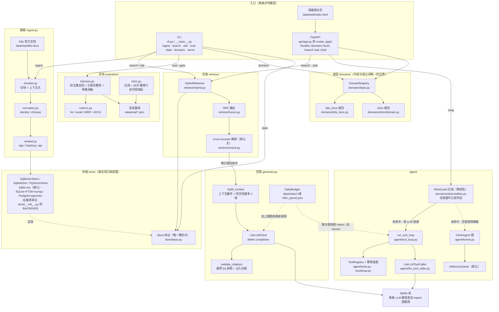

# kubedocs

> **A Rough Architecture for a Medical Agent** —— 面向**两个域**的检索问答与 Agent 平台：
> `k8s_docs`（Kubernetes 官方文档，英文）与 `clinic`（医疗问诊 / 挂号 / 紧急，中文）。
> 检索走混合召回（BM25 + 向量）+ RRF 融合 + 可选重排，回答**必须带可点击引用**，查不到就明说。
> **本机零容器即可跑通全链路**。

这是一个**工业级工程作品**（非研究原型）：重点不在"我实现了一个算法"，而在
**选型判断、可观测、评测驱动、成本与延迟约束、失败模式设计**。

```bash
python -m kubedocs.cli domains          # 列出可用域
python -m kubedocs.cli stats --verify   # 索引体检
python -m kubedocs.cli --hf-offline eval --gate   # 评测并卡闸门
```

**双域是刻意的**：内核（图、工具协议、状态、评测）与域（语料、语言、能力）解耦，
一份内核跑两个完全不同的域。设计记录见 [`docs/adr/0003-双域agent平台.md`](docs/adr/0003-双域agent平台.md)。

---

## 状态（诚实标注）

| 部分 | 状态 |
|---|---|
| 语料获取（1720 篇官方 markdown / 16.2 MB） | ✅ 已验证 |
| 切块器 + 真实语料体检 | ✅ 已验证（见「实测数字」） |
| 本地索引：SQLite + FTS5 + `sqlite-vec`（默认后端） | ✅ 已验证（含 FTS 一致性自检） |
| 增量/幂等摄取（文档级 + 块级跳过） | ✅ 已验证（幂等复跑 0 变更 / 1.6 秒） |
| 混合检索 + RRF 融合 + 单路消融 | ✅ 已验证（hybrid hit@10 = **0.84**） |
| 带引用回答 + 拒答 + 预算上限 | ✅ 已验证（含真实 LLM 端到端；**日上限现在覆盖 `/ask` 与 `/chat` 两条路径**） |
| 金标集（50 条）+ 指标 + 闸门 | ✅ 已验证（标注集自检 + 闸门能红） |
| **P0 双域地基**：域协议 / 多域索引 / 中文归一化 | ✅ 已完成（k8s 域指标零回归） |
| P1 医疗域资产迁移 | ✅ 已完成（三维门控 / 急诊红线 `domains/clinic/redline.py` / 号源库 `booking.py` · `sqlite_provider.py` / 知识卡片脚本 `scripts/clinic_build_cards.py`） |
| **clinic 检索轨真正接通** | ✅ 已验证（`DomainPack` 自报语料/归一化/嵌入，`ingest` 走 `pack.build_index()`）：`--domain clinic` 自动用 **jieba 分词 + `bge-small-zh-v1.5`（512 维）**，全量 **31,592 块**已建成，`verify_fts()`/`verify_vec()` 均 ok，中文查询真实命中。**此前 `--domain` 只换索引目录**，语料/归一化/嵌入仍是 k8s 默认值 |
| 观测：`/metrics` + OTel + `log_level` 生效 | ✅ 已完成（`src/kubedocs/observability.py`）；`otel_enable` 默认关，显式打开才导出 |
| P2 agent 内核（图 / 工具 / 持久化 / 中断） | ✅ 已完成（`agent/` 13 个模块：LangGraph `StateGraph` + 工具循环 + `InMemorySaver` + `interrupt` 续跑；单测在闸门内） |
| P5 FastAPI + 对话前端 | ✅ 已完成（`api/app.py` **10 个**端点：`/healthz` `/metrics` `/domains` `/tools` `/search` `/ask` `/chat` `/` `/console` `/patient`，+ `data/web/index.html` 演示页 + `data/web/console.html` 控制台 + `data/web/patient.html` 患者端 + `scripts/smoke_api.py` 冒烟；另有 `api/consult.py` 的 `/consult` 交互式临床问诊 **4 个**端点） |
| 一键启动（Windows） | ✅ 已验证（`start.cmd`：挑端口 → 起服务 → 轮询到**索引非空** → 开控制台页）。实测：8080 被占时自动跳到 8081；已有可用实例时默认附着（`--force` 强制另起） |
| `docker compose up` 全栈 | ✅ **已实测**（2026-10-13/14，Docker 29.8）：db + api 起来、健康检查通过、`/healthz` 报 **18822 块**（2026-10-14 重灌后）、`/metrics` 200、`/search` 真实命中（`overlap=13`，两路都参与融合）、`/chat` 的 SSE 红线**确定性转急诊**。过程中发现并修掉 4 个真实缺陷，见下面「Docker 全栈实测」 |

> 本项目坚持一件事：**没跑过的就不写"已完成"**。

---

## 为什么做这个（以及它和"从零手写"路线的区别）

我此前的项目（医疗预问诊 Agent）把检索、网关、认证、评测都自己写了一遍。那个项目适合讲
**领域深耕**（中文临床语境判定没有现成实现，只能自研）。但工业场景里更重要的判断是
**"什么该用成熟件、什么必须自研"**：

| 部件 | 本项目选择 | 理由 |
|---|---|---|
| 全文检索 | **SQLite FTS5**（默认后端，带 `bm25()` 排序 + 列权重）；生产 pgvector 侧是 **ParadeDB `pg_search` 的真 BM25**（`USING paradedb` + `pdb.score()`） | 标准库自带、零运维；Postgres 核心只有 `ts_rank`（**无 IDF、无长度归一化，不是 BM25**），实测它把 hybrid hit@10 从 0.84 拉到 0.74，换 `pg_search` 后是 0.86（见 [`docs/adr/0004-向量存储后端.md`](docs/adr/0004-向量存储后端.md) 第十节） |
| 向量检索 | **sqlite-vec**（默认；`sqlite`+numpy 与 `pgvector` 也在同一协议下） | 同一 `Store` 协议下换实现只改配置（`KUBEDOCS_STORE`）。vec0 换来的是"向量与块行同事务、可增删、不常驻内存"，**不是延迟**——它比 numpy 暴力内积慢约 11 倍（实测见 [`docs/adr/0004-向量存储后端.md`](docs/adr/0004-向量存储后端.md)） |
| 多路融合 | **RRF**（自实现，约 20 行） | 免标定、跨语料稳定，与 OpenSearch 内置策略同源 |
| 嵌入 | 本地 BGE-small-en（可切 API） | 医疗/企业语料常不允许出境；本地可离线复现，CI 不吃密钥 |
| 评测 | **自建金标闸门 + 标注集自检** | 闸门纪律（能失败、拒绝跨集比较、基线溯源）是框架给不了的 |
| LLM 网关 | **LiteLLM**（两条 LLM 路径各自直接调这个库，不共用同一个客户端类） | 多供应商路由/重试/回退/成本统计，自研是重复劳动 |
| Agent 编排 | **LangGraph**（`agent/kernel.py` 的图 + `interrupt` 中断续跑） | 耐久状态 + 中断恢复，不必自己写状态机与持久化 |

**存储为什么先是 SQLite 而不是 pgvector**：把"业务逻辑跑通"与"一键可复现部署"
拆成两个目标后，先做前者。判断依据、代价与边界写在
[`docs/adr/0002-先跑通业务逻辑.md`](docs/adr/0002-先跑通业务逻辑.md)；
完整选型记录见 [`docs/adr/`](docs/adr/)。

---

## 架构

下面这张图是**按 `src/kubedocs/` 的实际文件画的组件与数据流**（每个框都对应真实模块，
不是设想的架构）；再下面的示意图讲的是"本机形态 vs 生产形态"的取舍。



图里三处容易看图看错的地方，在这里说明白（都与上面的「状态（诚实标注）」一致）：

- `Store` 协议**不止一个实现**：`sqlite-vec`（默认，`store/sqlite_vec_store.py`）、
  `sqlite`（`store/sqlite_store.py`，SQLite + FTS5 + numpy 向量）、`pgvector`
  （`store/pgvector_store.py`，Postgres）、`milvus`（`store/milvus_store.py`，
  SQLite FTS5 + Milvus Lite 本地文件里的 **HNSW**——四个后端里**唯一真正提供 ANN 的嵌入式实现**）
  都在，后端名以 `store/__init__.py` 的 `BACKENDS` 与 `config.py` 的 `store` 字段为单一出口
  （默认值 `"sqlite-vec"`）。图里只画一个存储框，是为了突出"换实现只改配置"这条唯一耦合点，
  **不是"只有一个实现"**；第四种（milvus）的选型与实测见 `docs/adr/0005-milvus-后端.md`
  （含一个反直觉的实测结论：3000 块量级下 HNSW 与精确检索**逐位相同**、单查询 ~0.7s，
  比 `sqlite-vec` 慢得多——它换来的是"ANN 选项"，不是"更快"）。
- **两条 LLM 路径共用的是 `litellm` 这个库，不是同一个客户端类**：`generate.py` 里的
  `LiteLLMClient` 走 `litellm.completion`；`agent/llm_tool_caller.py`
  则是自成一体的 `LiteLLMToolCaller`，自己 `import litellm`
  直接调用，**全文不 import `LiteLLMClient`**。所以图里两条边分别指向 litellm 库。
  但**日预算**是**同一本账**：账本路径是 `Settings.llm_spend_path`（`config.py`，
  **全局一份，不在域目录下**），`generate.DailyBudget` 既挂在 `generate.py` 这条边上，
  也被 `run_tool_loop(..., budget=...)` 在**每次模型调用之前**检查
  （图里两条虚线都指向 `BUD`）。这一点**曾经是缺陷**：预算原先只挂在
  `generate.py` 这条边上，`/chat` 的工具循环不走它、成本只被累加进一个随对象丢弃的
  `self.cost` ⇒ `/chat` 没有日上限。修复记录（含"算不出价不许按 0 记"、**按域分账**曾把
  上限翻成 N 份、以及跨进程边界）见 `SECURITY.md` 的 S-2。
- `/chat` 有两条路径：有密钥走工具循环（模型决定控制流），无密钥降级到确定性图；
  红线在两条路径里都是**进循环之前**的确定性判定，而且**每一轮**都判——
  此前续答轮被直接送回 `observe`，用户在回答追问时才说出"胸痛"**不会**转急诊。
  挂号也**必须先确认**才占号（关键词命中 ≠ 同意占用号源）。
  `thread_id` 的**属主绑定**（首见即绑定 `patient_id`，换属主 ⇒ 409）与
  **LRU 上界**也在这一层（`api/threads.py`，见 `SECURITY.md` 的 S-3）。

```
   本机（当前，零外部依赖）                             生产形态（同一套业务代码）
   ─────────────────────────────                        ─────────────────────────
    CLI / FastAPI                                        api (FastAPI) ─▶ agent (LangGraph)
        │                                                     │
        ▼                                                     ▼
   ingest: 语料 ─▶ 切块 ─▶ BGE 嵌入 ─▶ 索引            LiteLLM ─▶ LLM 供应商
        │                                                     │
        ▼                                                     ▼
   ┌──────────────────────────────┐                  ┌───────────────────────┐
   │ Store 协议（唯一耦合点）     │  ← 换实现只需改配置 →  │ Postgres + pgvector │
   │ · SQLite FTS5（bm25 排序）   │                  │ · 同一 Store 协议     │
   │ · sqlite-vec 向量索引（余弦）│                  └───────────────────────┘
   └──────────────────────────────┘
        │
        ▼
   retrieve: 两路并行召回 ─▶ RRF 融合 ─▶（可选）cross-encoder 精排 ─▶ 引用组装
        │
        ▼
   eval: 标注集自检 ─▶ 指标(hit/recall/MRR/nDCG) ─▶ 单路消融 ─▶ 基线闸门
```

**检索链路**：`query → 两路并行召回(FTS5 + 向量) → RRF 融合 → 重排(可选) → 结果带引用`
每一段都有耗时与降级诊断（`search --explain` / `--json` 可见）。

**回答链路**：`检索 → 编号组装上下文 → LLM → 引用核对 → 带引用回答 或 拒答`

回答层的三条硬规则（都有单测）：

1. **只依据检索到的片段回答**，每个论断带 `[n]` 引用，与来源编号一一对应；
2. **检索为空就不调用 LLM**，直接拒答——既省成本，也不给模型"凭空作答"的机会。
   这条是可断言的（单测直接断言打桩 LLM **一次都没被调用**）；
3. **引用标记必须可核对**：`[n]` 只能指向真实提供的那 n 段片段；模型编出 `[99]`
   会被剥掉并记入诊断。**指向不存在来源的引用，比没有引用更有误导性。**
   回答里一个引用都没有，同样会被标记出来。

另外两条工程约束：系统提示明确要求**标识符逐字保留**（参数名/字段名/命令/错误码
不得翻译或缩写——对技术文档问答来说改写标识符等于答错）；LLM 花费按日累计落盘，
**到达上限即拒绝新调用**，而不是悄悄烧钱。

---

## 快速开始（本机，无需 Docker）

```bash
python -m venv --system-site-packages .venv
. .venv/bin/activate                  # Windows: .venv\Scripts\activate
pip install -e ".[dev]"

# 1) 拉语料（一次就够，1720 篇 / 16.2 MB）
python scripts/fetch_corpus.py

# 2) 建索引（增量；首次全量约 35 分钟，其中嵌入占绝大部分）
python -m kubedocs.cli --hf-endpoint https://hf-mirror.com ingest

# 3) 检索
python -m kubedocs.cli search "how do I stop a container using too much memory" --explain

# 4) 带引用回答（需要 LLM 密钥；没有密钥时只返回检索结果 + 明确原因，不会崩）
python -m kubedocs.cli ask "怎么限制一个 Pod 的 CPU？" --show-context

# 5) 索引体检（含 FTS 一致性自检）
python -m kubedocs.cli stats --verify


# 6) 评测：先预检标注集，再评测并卡闸门
python scripts/check_gold.py
python -m kubedocs.cli eval --write-baseline      # 首次冻结基线
python -m kubedocs.cli eval --gate                # 之后每次回归检查
```

### 知识依据在哪：语料**不入库**，按需下载/重建

RAG 检索到的**知识卡片就是检查/用药建议的唯一来源**（提示词 R3：检索不到就不给，
不许用模型的通用医学知识补足）。所以"语料在哪"这件事直接决定系统能说什么。

**语料本身不在仓库里**（体积 + 上游许可，见 [NOTICE.md](NOTICE.md)），克隆下来是空的：

| 语料 | 怎么拿到 | 进哪 |
|---|---|---|
| k8s 官方文档（1720 篇 / 16.2 MB） | `python scripts/fetch_corpus.py` | `data/raw/k8s-docs/` |
| clinic 知识卡片（31,592 张 / 8.4 MB） | `python scripts/clinic_build_cards.py`（从上游 OpenCMKG 三元组派生） | `data/clinic/cards.json` |
| clinic 科室补全映射表（4,727 条） | `python scripts/clinic_derive_departments.py --triples <triples.txt>` | `data/clinic/department_map.json` |

拿到语料后**建索引**（索引也可随时重建，不入库）：

```bash
# 本机（sqlite-vec，默认）
python -m kubedocs.cli --domain clinic ingest        # 首次全量约 1 小时（CPU 编码）

# 容器（pgvector，compose 里 KUBEDOCS_STORE=pgvector）
docker compose exec api python -m kubedocs.cli --domain clinic ingest
```

> **容器里的知识依据**：`docker-compose.yml` 把宿主 `./data` 挂进容器 `/app/data`，
> 所以**卡片文件与索引都在容器可见的同一个数据目录里** —— `data/clinic/cards.json`
> 是知识卡片本体，Postgres 的 `clinic` schema 是它的向量索引。
> 两者都不在镜像里，**按需下载/重建**；镜像只带代码与依赖。
>
> ⚠️ **换嵌入模型后索引必须重建，而 `--rebuild` 做不到这件事**：`--rebuild` 只
> `TRUNCATE` 表，而 `_ensure_schema()` 用的是 `CREATE TABLE IF NOT EXISTS`，
> `embedding vector(384)` 的列定义不会被改。实测：库里是 384 维而 clinic 域要
> 512 维（`bge-small-zh-v1.5`）时，`ingest --rebuild` 仍报同一个维度错。
> **正确做法是丢掉那个 schema**（索引是派生物，重建即可）：
>
> ```bash
> docker exec kubedocs-db-1 psql -U kubedocs -d kubedocs \
>   -c "DROP SCHEMA IF EXISTS clinic CASCADE;"     # 只动 clinic，k8s_docs 不受影响
> docker compose exec api python -m kubedocs.cli --domain clinic ingest
> ```

### 一键启动窗口（Windows）

上面这套手动步骤在 Windows 上被包成了一个脚本，双击即可：

```bat
start.cmd
```

它做四件事：挑端口（从 8080 起找第一个空闲的）→ 起服务 → 轮询 `/healthz` 直到**真的**健康 →
打开控制台页面。那个窗口就是服务的控制台，日志打在里面；Ctrl+C 或关窗口即停止
（前台运行，不会留下一个孤儿进程占着端口）。

- 8080 上**已经有**一个 kubedocs 在跑时（比如 `docker compose up -d` 起的），它默认直接
  附着过去、只打开页面，不再另起一个；要强制另起用 `start.cmd --force`。
- 其它开关：`--domain clinic`、`--port 9000`、`--no-browser`、`--online`
  （默认带 `--hf-offline`，因为模型已在本地缓存里；原因见下方"环境约束"）。

四个入口职责不同，不要互相替代：

| 路径 | 是什么 |
|---|---|
| `/console` | 控制台：索引体检、`/metrics` 摘要（含非 2xx 单独计数）、每路检索名次、`/ask` 的降级原因、问诊 SSE 轨迹 |
| `/` | 演示页：检索 / 工具清单 / 问诊的最小示例 |
| `/patient` | 患者端：**只**保留问诊 agent（无域选择、无 API 地址、无 top_k、无指标），面向真实使用者 |
| **`/consult`** | **交互式临床问诊（多轮）**：主页**只有对话**——科室建议、可能病症排序、检查与用药建议都由大模型用医生口吻在对话里讲出来。走 `ClinicalPipeline`（契约化输出），不是 `/patient` 那条图 + 工具循环的老路径 |

### 交互式问诊（`/consult`）：自己点着测

起服务后直接开 <http://127.0.0.1:8080/consult>（本机另起实例时用 `--port` 指定的端口）：

```bash
.venv/Scripts/python.exe -m kubedocs.cli --domain clinic serve --port 8082
```

**产品形态：主页只留对话区。** 结构化结论（科室 / 病症排序 / 检查 / 用药 / 小结 / 依据）
全部**移到后台**，作为大模型的参考与判断依据，由它在对话里讲给用户听
（提示词 `clinical/prompts/system.md` 第三之二节规定了讲什么、按什么顺序、什么口吻）。
响应 JSON 里仍然带着这些结构化字段——后端留档、契约校验、运维排查都要用——但**前端不渲染它们**，
这条由 `tests/unit/test_consult_api.py::TestPageIsDialogueOnly` 锁住，防止面板被悄悄加回来。

- **科室建议与用药建议不主动交代**（提示词 R7）：主答案只讲"现在该怎么办（含紧急度）→
  可能方向排序（每项都讲为什么）→ 检查建议 → 何时必须立刻去医院"，结尾用**一句话**引导
  患者来问科室/用药。理由：一次全倒出来会**淹掉真正紧急的那句**。
  **急重症不受此约束**——判出 `red_flags` 时科室/去哪必须当场说清，安全信息永远不藏。
- **追问要答得一致 ⇒ 必须有上文**：会话保留最近 `MAX_HISTORY_TURNS` 轮对话，
  且**助手那一侧存的是契约 JSON 而不是散文**（存散文时模型会跟着写散文、
  不再输出 JSON ⇒ 整轮降级，实测踩过）。
- **急诊横幅只跟模型的判断**：`emergency` = 模型这一轮判出 `urgency=emergency`，
  且该结论**真的出自模型**（`degraded` 非空表示主判没走通、结论来自兜底，不算模型判断）。
  **红线不再是关键词表**——急重症由模型按「病症 + 严重程度」判断，输出到可审计的
  `red_flags`（`condition` + `severity` + `why`，见 `contracts.RedFlag` 与
  `clinical/prompts/system.md` R1）。关键词表（`domains/clinic/redline.py`）**已退出判断链**：
  不进提示词、不影响 `urgency`、不触发横幅，只在**主判不可用**时给一句保守对话提示。
  实测：`「胸骨后压榨样疼痛，向左放射，伴大汗」` 在旧表下**一个词都不命中**，
  现在能正确判为 `critical` 并报急诊。
  > ⚠️ **两条临床路径的急诊设计是相反的**：图路径（`/chat`、`/patient`）**仍用**
  > 关键词强制边（LLM 不可绕过）；临床管线（`/consult`）把判断权交给模型。
  > 取舍相反、故意并存，改急诊相关代码前先确认走的是哪条——见 `domains/clinic/redline.py` 顶部那张表。
- **工具由模型自己调度**：代码只给工具清单与执行器（`agent.tools.ToolRegistry` 是唯一真相源），
  模型自己决定调哪个、调几次（`clinical/orchestration.py`）。代码只保留轮次上限、
  工具白名单（**副作用工具默认不给模型**）、以及证据编号分配（`K1`…）。
- **风险不会静默消失**：关键词命中而模型未判急重症时，回传 `keyword_hit_conflict=true`，
  并在对话正文**追加**一句风险提示——**只进对话，不弹横幅**。
- **多轮采问**：`session_id` 复用同一份 `IntakeState`；有工具循环时追问由模型决定（R5）；
- **降级会说**：模型没走通时对话里插一条系统提示，不会把兜底文案伪装成模型结论；
- **会话在进程内**：重启即丢、多副本不共享（`GET /consult/status` 会直接这么告诉你）；
- 端点：`GET /consult`（页面）、`POST /consult`（推进一轮）、`POST /consult/reset`、`GET /consult/status`。

### 分诊效果怎么测：直接用原型那套 500 例分层金标

`scripts/eval_prototype_patients.py`（**离线、免费、确定**）跑
`data/eval/prototype/patients.json`——原型用 LLM 生成的 **500 例带标签病例**
（`severity` × `style` 分层，带 `gold_department` / `gold_diseases`），
按严重度与语言风格**分层报**，并单列"重症档有没有给急诊科"。

实测（kubedocs，500 例）：全部 top-1 28.8% / top-3 47.4%；**severe 档 top-1 仅 5.0%、
含急诊科 14.0%**；**口语表述掉得厉害**（formal 42.4% → vague 16.0%）。
这两个数就是当前最该改的地方。

⚠️ 两点限定：金标由 LLM 生成、**未经医学人员复核**，衡量的是"对这套分层用例的符合度"；
它**不与原型自己报的 87%/85%/12% 可比**（原型评的是 `ground()` 自推导标签，分母不同）。


### 把工具暴露给外部客户端（MCP）

工具定义来自 `ToolRegistry` 这一份真相源，MCP 只是把它翻译出去——
**不另写第二份定义**（两份定义早晚不一致，那正是本项目一直在删的东西）。

```bash
python -m kubedocs.mcp.server                          # clinic 域，只暴露只读工具
python -m kubedocs.mcp.server --allow-side-effects     # 同时暴露挂号（调用时仍须 confirm=true）
```

**副作用默认不外露**：挂号会真的占号，而 `BookParams` 没有确认字段；原样暴露等于让任何
MCP 客户端跳过我们那条"未确认绝不取号"的性质。开启后服务端会给这类工具的入参 schema
**注入必填的 `confirm: boolean`**，调用时必须为 `true`——确认这道关在 MCP 边界上仍然存在，
而不是写进一句说明里靠调用方自觉（详见 `src/kubedocs/mcp/__init__.py`）。

### 两个评测脚本（离线/免费 与 需要模型）

```bash
python scripts/eval_prototype_cases.py        # 离线免费：症状三维判定 + 急诊假阳性 + 医疗/非医疗区分
python scripts/eval_medical_cot.py --dry-run  # 只加载数据与后端，不调模型
python scripts/eval_medical_cot.py --limit 20 # 真跑（每条一次模型调用，走同一本日预算账）
```

不想下载模型（离线/受限网络）时，用确定性哈希向量跑通管道：

```bash
python -m kubedocs.cli --provider hashing ingest --limit-files 100
```

> `hashing` 只擅长字面重合，**不能用于任何质量结论**；它存在的意义是让管道可离线自测。

退出码约定（供脚本与 CI 判断，不必解析 stdout）：
`0` 成功 ／ `1` 参数错误 ／ `2` 闸门不通过 ／ `3` 索引为空、标注集不合法等前置条件不满足。

---

## 实测数字

> ### ⚠️ 先读这一段：本节数字绑定"当时抓到的那份语料"
>
> **上游语料取自 `main`，没有钉版本**（`scripts/fetch_corpus.py` 下 codeload tarball），
> 所以"重跑一遍文档里的命令"**不保证**得到同一批数据。实测：
>
> | | 2026-10-12（本节留档） | 2026-10-14 重拉后 |
> |---|---|---|
> | 文档 | 1720 篇 | **1722 篇**（上游多了 2 篇） |
> | 块数 | 18811 | **18822** |
> | `corpus_sha` | `f6be8d659a348c60` | `f9ffa225825bd593` |
> | hybrid hit@10 / mrr@10 | 0.8400 / 0.5205 | 0.8400 / **0.5239**（未退化） |
>
> 语料变了就**必须**重冻基线（CONTRIBUTING 第 5 节），已在 2026-10-14 执行；
> 闸门现在会用 `corpus_sha` **精确**拒绝跨语料比较，逃生口是 `--allow-corpus-drift`。
> **读本节时请把数字当"某次实测的留档"，而不是"永远如此"**——
> 想知道当前值就跑那条命令（每张表都写了命令）。

### 语料与切块（`python scripts/chunk_stats.py`，1720 篇官方文档）

| 项 | 值 |
|---|---|
| 文件 / 体积 | 1720 篇 markdown / 16.2 MB（与 GitHub 树接口预测**完全一致**） |
| 块数 | **18811**（本次修掉"重叠尾段切进代码围栏"之后的值；修前 18861） |
| 块长 中位 / p95 | 759 / 1621 字符 |
| 含代码块的块 | 15.1% |
| 非法引用 URL | **0** |
| 内容逐字重复块 | **1.12%**（211 块，见下） |
| 切块吞吐 | ~589 文件/s（2.9s / 1720 篇） |

> **关于 `18861` 与 `18811` 这两个数**：ADR-0002 / 0003 / 0004 里写的 `18861` 是它们
> **各自当时的实测留档**，按本项目的纪律**不追改历史**（那等于篡改记录）。差异来源只有一个：
> 本次修掉了"重叠尾段切进代码围栏"，块数因此从 18861 变成 **18811**。
> 两者对应的检索指标**逐位相同**（hybrid hit@10 都是 0.8400），所以那些 ADR 的结论仍然成立。

**体检驱动的四次修正**（都在真实语料上量化过）：

| 问题 | 修法 | 效果 |
|---|---|---|
| API reference 的 HTML 表格原样入库（占语料 59%） | `strip_html`：剥标记留文字、表格转可读行、**不碰代码围栏** | p95 块长 2125 → 1540（加"文档标题 › 面包屑"上下文头后为 1621，见上一行表） |
| 重叠按字符硬切，产生 `...rip between` 这类半截块 | 重叠对齐到词/行边界，对不齐就放弃重叠 | 消除词中断块 |
| 模板化小节跨文档同形 → **30.7% 逐字重复块** | 块首加「文档标题 › 面包屑」上下文头 | 重复 **30.7% → 1.12%** |
| **重叠尾段落在代码围栏内部**：块首变成半截 YAML（开头的 ``` 留在上一块里），与"永不切进代码围栏内部"直接冲突 | `_safe_overlap_tail` 判断点是否在围栏内，在内则**放弃重叠** | 围栏数为奇数的块 **581 → 25**（−95.7%）；块数 18861 → 18811；**检索指标逐位不变**（hybrid hit@10 修前修后都是 0.8400）。残留 25 块分布在 15 篇文档，形态是块内围栏数 3/5（多段代码交错），与本次修的"块首落在围栏内"不是同一形态 |

### 嵌入吞吐（决定全量摄取时长，i7-13700H / 14 核 / 纯 CPU torch 2.11）

| 项 | 值 |
|---|---|
| 模型 | BAAI/bge-small-en-v1.5（384 维，max_seq 512） |
| 吞吐（真实块，中位 195 token） | **约 9.4 块/s ≈ 1900 token/s** |
| 长度分桶（按长度排序后编码） | **无收益**（59.5s → 58.9s）——瓶颈不是 padding |
| 线程数 4 / 8 / 14 | 5.3 / 9.2 / 9.1 块/s（≥8 线程即饱和） |
| batch 32 / 64 / 128 / 256 | 9.3 / 9.4 / 8.1 / 6.9 块/s（**批越大越慢**） |

⇒ 一次全量摄取≈35 分钟，**嵌入是整条链路的成本瓶颈**。这些负面结论同样有价值：
它们排除了"调 batch/分桶就能加速"的假设，说明下一步该做的是量化/ONNX，
而不是继续调参。超长块（>512 token）会被静默截断，摄取时会明确计数并打印。

### 全量索引（`python -m kubedocs.cli ingest`，真实 bge-small-en）

| 项 | 值 |
|---|---|
| 扫描 / 变更 / 未变 | 1720 / 1720 / 0（本次是 `--rebuild` 全量重建） |
| 写入块数 | **18811**（与切块器预测**逐块一致**） |
| 编码 / 复用向量 | 18600 / 158（复用来自跨篇同内容块） |
| 空文档 | **65** |
| **超长被截断** | **482 块（2.6%）** —— 尾部内容在向量路上检索不到，但全文路仍可命中 |
| 总耗时 | 3427.6s（57.1 分钟；本轮重建期间机器上还有并发任务，吞吐约 5 块/s，低于下表的 9.4 块/s） |
| FTS / 向量一致性自检 | 都是 ok |

### 检索质量与延迟（50 条标注，`eval`，`top_k=10`）

| 模式 | hit@10 | recall | MRR | nDCG | p50 | p95 |
|---|---|---|---|---|---|---|
| **hybrid（FTS5+向量+RRF）** | **0.8400** | 0.76 | **0.5205** | 0.5469 | **107.8 ms** | **228.1 ms** |
| dense-only | 0.7800 | 0.71 | 0.4346 | 0.4818 | 78.5 ms | 197.7 ms |
| bm25-only | 0.7200 | 0.66 | 0.3822 | 0.4467 | 18.1 ms | 35.1 ms |

> ⚠️ **口径（两个"变了"与一个"没变"）**：
> 1. **指标逐位复现**：hybrid 的 hit / recall / MRR 与修切块器之前**完全相同**（0.8400 / 0.76 / 0.5205），
>    nDCG 只差 +0.0005；bm25 与 dense 的 recall/MRR 略有上升。也就是说"修掉半截代码块"这件事
>    **没有让检索变好或变差**——这是一次纯质量中性的可维护性修复。
> 2. **延迟数字变了，且原因不在这次改动**：上表是本次（2026-10-12）在本机的实测；
>    更早冻结的基线里 hybrid p50/p95 是 **61 / 76 ms**。但**在我动手改任何代码之前**、
>    用当时的原始代码与原始索引测，得到的就已经是 **146.5 / 244.9 ms**——
>    也就是说这组延迟在当前机器状态下**本来就复现不出来**。
>    证据方向很明确：bm25-only 的延迟与基线几乎一致（18.1 vs 18.9 ms），
>    只有**向量路**慢约 2×（78.5 vs 43.1 ms），而向量路的代码在这次改动里没被动过。
>    没有证据表明是本次改动造成的；也**没有**把原因查清（可能是本机负载/热状态/页缓存），
>    所以这里把两个数字都留着，不拿一个去覆盖另一个。
> 3. `n_chunks` 从 18861 变成 18811（−0.27%），所以基线已按 CONTRIBUTING 第 5 节的纪律
>    重新冻结（`eval --write-baseline`）；**金标指纹没有变**（`gold_sha256` 仍是
>    `3eee2503682df8ca`）——变的只是索引规模，不是尺子。
> 4. **第二次重冻（2026-10-14）**：上游语料变了（1720→1722 篇、18811→18822 块、
>    `corpus_sha` `f6be8d65…`→`f9ffa225…`），再次按同一条纪律重冻。
>    hit@10 前后**都是 0.8400**，mrr 0.5205→0.5239、ndcg 0.5469→0.5495。
>    同时把闸门的语料判据从"2% 块数容差"换成 `corpus_sha` 精确比较——
>    因为正是那次 +0.058% 的漂移暴露了旧判据会**静默放行**跨语料比较。

> 延迟是在 P0 里**顺带修掉一个一直存在的缺陷**之后的数字：`keyword_search` 原先在 FTS 上
> 直接 `JOIN chunks` 取 `chunk_id`，导致执行计划变成"把 9000 多行命中全连上再排序"。
> 实测分解：纯 MATCH 0.04ms → 加 `ORDER BY bm25` 6.6ms → **加 JOIN 57.5ms**。
> 改为两步取（先取前 N 个 rowid，再按 rowid 查 `chunk_id`）后 hybrid p50 163→61ms、
> p95 245→76ms（相对最初基线 2.1× / 2.4×），**且检索指标逐位不变**。
> 详见 [ADR-0003 第六节](docs/adr/0003-双域agent平台.md)。

按问题类型（hybrid）：

| 类型 | 条数 | hit@10 | MRR |
|---|---|---|---|
| identifier（`topologySpreadConstraints`、`--eviction-hard` …） | 15 | **1.0000** | 0.5767 |
| paraphrase（"容器吃内存太多怎么办"） | 15 | 0.8000 | 0.4951 |
| concept（"一个 Pod 会经历哪些阶段"） | 20 | 0.7500 | 0.4975 |

**混合检索确实有效**：比最好的单路（向量）高 6pp，比全文路高 14pp。分类型看原因很清楚——
**全文路在 paraphrase 上更强**（0.60 vs 向量 0.47），而**向量路在 concept 上更强**（0.90 vs 0.60）——
两条路各有一段强项，这才是"加一路"的理由；而两者融合后 paraphrase 达到 0.80，
**高于任何单路**（0.60 / 0.47）。这正是加一路的意义。

**但有一个反向发现，如实记录**：concept 类里 **dense-only（0.90）反而高于 hybrid（0.75）**。
即在这 20 条概念型提问上，全文路带进来的是噪声而非信号。逐路复查（hybrid 漏 5 条、dense 漏 2 条）：
净 −3 是 **4 失 1 得**，而那 4 条的 dense 名次分别是 **6 / 2 / 9 / 10 —— 没有一条是第 1 位**。
（早先写成"3 条本来排第一被挤出前 10"，那个说法不成立。）这与"混合一定更好"的直觉相反，也说明**统一权重不是最优**——
候选改进是"问题里出现标识符才启用全文路"或按类型调权。但口径要说准：`1.96·√(0.84·0.16/50) ≈ ±10pp`
是**50 条整体**的置信区间；套到这 20 条子集上应为 **±19pp**（早先误写成"20 条样本 ±11pp"）。
无论用哪个数，差距都还不够支撑改默认参数——
**这个差距还不足以支撑改默认参数**，所以先记录、不改（见
[`docs/检索与评测口径.md`](docs/检索与评测口径.md) 第五节）。

### 标注集修正的留档（改了尺子就必须说）

首次评测 hybrid hit@10 = **0.68**（bm25 0.56 / dense 0.64）。用
`scripts/diagnose_misses.py` 逐条复查 16 条未命中后，发现 **8 条是标注问题而非检索失败**：
我按单目标标注，而检索返回的是**同样正确**的另一篇（例如问"Pod 一直重启"，
`pod-lifecycle` 的重启策略小节与 `debug-running-pod` 的 CrashLoopBackOff 都算对；
问"给整个命名空间设 CPU 上限"，操作页 `quota-memory-cpu-namespace` 甚至比概念页更直接）。
这 8 条改成多目标并把理由写进 note，**修正前后两个数字都留在这里**。
剩下 8 条是真实失败，例如：

| 未命中 | 实际返回（前 10 里最接近的） | 性质 |
|---|---|---|
| "add or remove pods automatically as traffic changes" | `static-pod`（"静态 Pod 的动态增删"） | 词面对上、语义完全跑偏——典型失败 |
| "how does the cluster decide where to put a newly created pod" | `topology-spread-constraints` | 调度器概念页没被召回 |
| "renew cluster certificates before they expire" | `kubeadm_certs_renew_*`（10 条全是自动生成的 stub 页） | 自动生成参考页挤占结果 |
| "let people on the internet reach my app using a hostname" | `debug-service` | ingress 页未召回 |

### Docker 全栈实测（2026-10-13，Docker 29.8 / compose v2）

`docker compose up -d` 起来后实测通过的项：

| 检查 | 结果 |
|---|---|
| `db`（`paradedb/paradedb:0.26.1-pg16`） | healthy；扩展 `pg_search` + `vector` 齐全 |
| `api` 容器 | healthy，非 root（`USER app`，uid 10001），8080 已映射 |
| `GET /healthz` | `{"ok":true,"domain":"k8s_docs","n_chunks":18822}` |
| `GET /metrics` | 200 + `text/plain; version=1.0.0`；`kubedocs_http_requests_total` 等按**路由模板**打标签，计数随请求增长 |
| `POST /search` | 3 条真实命中、`degraded` 为空（模型从挂载卷加载成功）；`overlap=13` ⇒ 关键词路与向量路**都**参与了融合 |
| `POST /chat` | SSE 200：`thread` → `tool`（`check_red_line` 命中「胸痛」）→ `message`（`status: emergency`）→ `done` |
| `GET /tools?domain=clinic` | `book_appointment, check_citations, get_availability, list_departments` |
| `GET /console` | 200，控制台页（`data` 是挂载卷 ⇒ 改 HTML **不用重建镜像**，重启进程即可） |
| 容器实际用的后端 | `pgvector`（`KUBEDOCS_STORE=pgvector`）；容器内 `stats --verify`：1722 文档 / 18822 块，FTS 与向量一致性均 `ok` |

**这次实测抓到 4 个只有真起容器才会暴露的缺陷（都已修）：**

1. **容器内 `repo_root()` 解析错**（最严重）。`repo_root()` 从 `__file__` 上溯三层，而容器里包是
   `pip install .` 装进 venv 的 ⇒ 解析成 `/opt/venv/lib/python3.10`，`data/` 指向一个不存在、
   也写不进去的目录。而 `/healthz` **照样返回 200**（"索引不可用"按设计不算存活失败），
   表现是"服务是绿的、`n_chunks` 是 0、`/search` 报
   `PermissionError: '/opt/venv/lib/python3.10/data'`"。修：`repo_root()` 支持
   `KUBEDOCS_REPO_ROOT` 覆盖，compose 里设成 `/app`。**本地与 CI 不设它，行为逐字不变。**
2. **`HF_HOME` 落在非 root 用户读不到的地方**。Dockerfile 原来写
   `/root/.cache/huggingface`，而容器以 `app` 运行、`/root` 是 0700 ⇒ 挂进卷的模型
   **对 app 不可读**，容器内检索会静默降级成"没有向量路"。修：改到
   `/home/app/.cache/huggingface` + `chown`，compose 的挂载点同步。
3. **依赖层与源码层耦合 + 无谓的编译器**。原来 `COPY src` 之后才 `pip install .`，
   于是**改一行源码就要重下几 GB 的依赖**；而且 builder 里装了 `build-essential`
   （64 个包 / 87 MB），但依赖其实全是 manylinux wheel，在受限网络下这一层实测
   **>18 分钟仍没下完**。修：先装依赖（空占位包）再 `COPY src` + `pip install --no-deps .`；
   编译器改成 `BUILD_TOOLS=1` 按需开启（默认不装）。
4. **`KUBEDOCS_DATABASE_URL` 是个假开关**。compose 给 api 设了 `DATABASE_URL` 指向
   `db` 服务，但 `Settings.store` 的默认值是 `sqlite-vec`，而它**不读** `database_url`——
   于是容器实际去读 bind-mount 进来的 `./data/index/<domain>/kubedocs.db`，
   把旁边那个灌满 18811 块的 Postgres 完全晾着（`db` 服务白起）。表现同样是
   "服务是绿的、`n_chunks` 是 0"：SQLite 跑在 Windows bind-mount 上会报
   `OperationalError: disk I/O error`，而 `/healthz` 照样 200。修：compose 里
   `KUBEDOCS_STORE: pgvector` 与 `DATABASE_URL` **成对**给出。修后容器内
   `stats --verify` → 1722/18822、FTS 与向量一致性均 `ok`，`/search` 两路都参与融合。

**镜像体积（如实记录，未在本机跑完）**：PyPI 上的 `torch` 默认是 **CUDA 版**，
会多拉约 2.5 GB 的 `nvidia-*` / `triton` / `cuda-toolkit`，实测镜像 **9.91 GB**——
而这个服务是**纯 CPU** 的。已给出可选配方（`TORCH_CPU_FIND_LINKS` + `TORCH_CPU_VERSION`，
必须连版本一起给，否则 pip 会挑数值更大的 CUDA 版），本机实测能把 torch 从 553 MB + 一堆
CUDA 包降到 **184 MB**；但那次构建在外网下载停滞中被打断，**没有跑完**，
所以"镜像能瘦到多少"在这里不作断言。

**构建的资源与网络要求（实测）**：需要约 **15 GB 空闲磁盘**（中间层 + 9.91 GB 镜像）——
本机 C 盘曾只剩 0.5 GB，构建直接以 `OSError: [Errno 5] Input/output error` 失败；
Docker 的数据目录在 C 盘时尤其容易撞上。构建还**不消费 `requirements.lock.txt`**：
镜像里的依赖比锁文件新不少（实测 `langgraph` 1.2.15 / `litellm` 1.105.0 / `torch` 2.14.1，
而锁文件与本地 venv 是 1.2.12 / 1.102.1 / 2.11）——这与 CI 侧"装的是当时最新版"是同一个缺口。

**基础镜像仍是浮动 tag**：`python:3.10-slim` 现在解析到 **Debian 13（trixie）**，
而 compose 自己写着"版本都钉死"。这条**没修**（改 tag 会连带影响运行时依赖），如实记下。

### 环境约束（实测，决定了取数方式）

| 通道 | 结果 |
|---|---|
| `git clone github.com` | ❌ 连不上（21s 超时） |
| raw.githubusercontent / jsDelivr / statically / githack | ❌ 全部连接被拒 |
| GitHub API | ✅ 可用但 **限流 60/h**（取 1720 个文件必然撞墙） |
| codeload tarball | ✅ 335 MB / 2.1 分钟 |
| huggingface.co | ❌ 超时 → 走 **hf-mirror.com** ✅ |
| Docker Hub（`registry-1.docker.io`） | ✅ **现在可用**（实测拉下 `alpine`、`python:3.10-slim` 已在本地）。早先记为"连接被拒"，已过时 |
| **容器内 `deb.debian.org`** | ⚠️ **TCP 能连、HTTP 取包被中断** → `apt-get install` 直接失败。构建要传 `APT_MIRROR`（实测 `mirrors.aliyun.com` 可用） |
| **容器内 `download.pytorch.org`** | ⚠️ 同上（TCP 通、传输挂死）→ CPU-only torch 不能从官方源拿；阿里云 `pytorch-wheels/cpu/` 目录可用（cp310 有 54 个 `+cpu` wheel） |
| **外网大文件传输（通用）** | ⚠️ **反复停滞**：同一构建里 tuna 镜像能把 553 MB 的 torch 拉完，另一条 184 MB 的 wheel 却卡死 6 分钟零字节。构建脚本必须可重跑，不能假设一次成功 |
| 已缓存模型的联网校验 | ❌ **挂死 >10 分钟** → 必须 `--hf-offline`（载入 0.8s） |
| **宿主提交内存（16 GB 机器）** | ⚠️ 本机同时跑着 Docker Desktop 时，提交上限只剩约 1.6 GB；此时**主机进程**加载 torch 会以 `OSError: 页面文件太小 (os error 1455)` 失败，`/search` 降级成纯 BM25（`diagnostics.degraded` 会写明原因、HTTP 仍是 200）。内存宽裕后同一条路完全正常：实测 `overlap=13`、`degraded` 为空。⇒ 这是**瞬时资源**问题，不是代码问题；`/console` 的降级条会直接告诉你当前走的是哪条 |
| 检索冷启动 | ⚠️ 首次检索要加载嵌入模型，本机实测**墙钟 69 s**（之后 0.1 s）。`create_app()` 有意不加载模型（保持启动廉价），所以 `/console` 的检索面板会把等待秒数实时抖出来 |

⇒ 取语料唯一可行路径是 tarball 流式解包，见 [`scripts/fetch_corpus.py`](scripts/fetch_corpus.py)。

---

## 性能基准（2026-10-14，本机 16 GB / 20 逻辑核 / Windows 11）

命令：`python scripts/bench_api.py`（HTTP 并发）、`python scripts/bench_store_latency.py --backends all`（存储层）、
`python -m kubedocs.cli eval`（检索质量与延迟）。
**原始结果都在仓库里，可以自己复核**：`data/eval/api_bench/*.json`（HTTP 并发，含修复前后与容器/本地两侧）、
`data/eval/store_bench/latency.json`（存储层）。

> ⚠️ **本机不是基准机**：同时跑着 Docker Desktop + 两个容器 + 若干模型进程。
> 下面的数字只对"这台机器、这一次"负责，**不要当容量规划依据**。
> 这一节同时给出"**没测什么**"，见最后一张表。

### 1) HTTP 并发（`scripts/bench_api.py`）

`/search`，每档 32 个请求、4 个预热丢弃，`top_k=10`：

| 并发 | 本地直跑 吞吐/s | 本地 p50 / p95 ms | 容器(pgvector) 吞吐/s | 容器 p50 / p95 ms |
|---|---|---|---|---|
| 1 | 12.38 | 80.4 / 83.0 | 10.20 | 97.5 / 108.3 |
| 2 | 14.70 | 132.0 / 170.5 | 17.75 | 105.5 / 198.3 |
| 4 | 11.64 | 350.2 / 528.7 | 21.15 | 178.0 / 237.2 |
| 8 | 12.31 | 650.4 / 957.4 | 19.17 | 405.4 / 476.2 |

**读法**：两条路线的**吞吐都在两位数/秒就饱和**，而 p50 随并发**线性上涨** ——
这是"并发 1 就已把 CPU 吃满"的典型形态：加并发不换来吞吐，只换来排队。
`/search` 的成本大头是**查询编码**（下面第 2 张表：dense-only p50 65 ms vs bm25-only 14 ms），
而单次编码已经能把多核吃满，所以并发没有叠加收益。

容器在 c≥2 时反超，是因为它的 CPU 更"独占"（在自己的 WSL2 VM 里）；
但它的**固定开销**明显更高：同一个几乎不干事的 `/healthz`，容器 p50 是
97.5→（见第 4 张表）量级，本地只要 1.6 ms —— 跨 Docker Desktop 端口转发的代价在 Windows 上不可忽略。

### 2) 检索质量与延迟（`cli eval`，50 条标注，18822 块）

| 模式 | hit@10 | recall | mrr | ndcg | p50 ms | p95 ms |
|---|---|---|---|---|---|---|
| hybrid | 0.8400 | 0.7600 | 0.5205 | 0.5469 | 84.1 | 100.2 |
| bm25-only | 0.7200 | 0.6600 | 0.3822 | 0.4467 | 14.1 | 24.9 |
| dense-only | 0.7800 | 0.7100 | 0.4346 | 0.4818 | 65.2 | 74.0 |

⇒ 混合检索把 hit@10 从 0.72/0.78 提到 **0.84**，代价是延迟取两路之和；
dense 路贡献了 **~80%** 的端到端延迟。

### 3) 存储层（`scripts/bench_store_latency.py`，18822 块 × 150 样本）

| 后端 | dense p50 | dense p95 | keyword p50 | keyword p95 |
|---|---|---|---|---|
| `sqlite-vec`（默认） | 20.03 ms | 22.13 ms | **11.31 ms** | 23.78 ms |
| `pgvector`（生产） | **4.69 ms** | 8.10 ms | 58.60 ms | 77.80 ms |
| `sqlite`（旧实现） | 打不开（见下） | — | — | — |

跨后端 top-10 一致性（基准 = `sqlite-vec`）：

| 后端 | 向量路 名次相同 / 集合相同（平均重合） | 全文路 名次相同 / 集合相同（平均重合） |
|---|---|---|
| `pgvector` | 135/150 · 135/150（0.9840） | 18/150 · **51/150**（0.8960） |

**读法**：换后端是**权衡，不是升级** —— `pgvector` 的向量路快 4.3×（HNSW vs 穷举），
但全文路慢 5.2×。这一点在 hybrid 下会互相抵消，所以"选哪个"要按语料与查询形态定。
向量路的跨后端一致率 90%（HNSW 是近似索引，本来就不保证逐位相同）；
**全文路集合一致率只有 34%，值得单独查** —— 两个引擎都是 BM25，但 FTS5 与
`pg_search` 的分词/打分细节不同；`verify_fts()` 返回 `ok`，所以这**不是**降级路径造成的。
本仓库**没有**声称两个后端的检索结果相同（协议只保证接口一致），但这个差距比预期大，
记在这里而不是藏起来。

> `sqlite`（旧的 numpy 侧车实现）在当前索引上**打不开**：`vector_row` 全是 -1，
> 因为这份索引是 `sqlite-vec` 建的，而 `chunk_vectors.npy` / `vector_row` 只有
> `sqlite` 后端维护。它的报错信息**原先会误导**（建议 `ingest --rebuild`，而默认后端
> 仍是 `sqlite-vec`，重建后照样打不开），已改成明确指出"重建必须指定同一个后端"。

### 4) 探针开销：一个被实测抓出来并修掉的性能缺陷

`/healthz` 每个请求都调 `_DomainRuntime.stats()`，而它里面那条
`SELECT COUNT(*) FROM chunks WHERE body LIKE '%```%'` 是 18822 行大文本列的**全表扫描**。
用 store 自己的连接测（同一口径）：

| 查询 | ms/次 |
|---|---|
| `COUNT(documents)` | 0.01 |
| `COUNT + SUM(n_chars)` | 3.94 |
| **`COUNT WHERE body LIKE '%```%'`** | **17.31** |
| `SELECT meta` | 0.01 |
| **`stats()` 合计** | **24.40** |

`/search` 也会走它（`_index_note` 只为拼一句提示），且整段都在 store 锁里 ⇒
每个请求都要过一次 ~20 ms 的串行临界区。修法：`stats()` 加 **2 秒 TTL 缓存**
（探针间隔是 10 s，所以看到的仍是"最多 2 秒前"的真实状态）。修复前后：

| 并发 | `/healthz` p50 修复前 → 后 | 吞吐/s 修复前 → 后 |
|---|---|---|
| 1 | 54.6 ms → **1.6 ms** | 19.0 → **581** |
| 8 | 415.5 ms → **8.2 ms** | 19.2 → **894** |
| 16 | 802.2 ms → **27.7 ms** | 19.6 → **495** |

⚠️ 同一修复对 `/search` **几乎没有帮助**（c=1 的 p50 82.2 → 80.4 ms）——
因为它的瓶颈是编码而不是这次扫描。**这正是"先量再改"的价值**：如果只看
"`/search` 慢"就去优化那条 SQL，会白干。

### 5) 摄取 / 评测 / 测试耗时

| 环节 | 实测 |
|---|---|
| 嵌入吞吐（400 个真实块，`bge-small-en-v1.5`） | **8.55 块/s**（117 ms/块）⇒ 外推全量 **36.7 分钟 / 18822 块**（与「嵌入吞吐」一节的 ~35 分钟吻合） |
| 增量摄取（语料无变化时） | 38.7 s：扫描 1722 文件、变更 28、写入 520 块、**编码 45 块 / 复用 475 块（省 91.3%）** |
| `cli eval --top-k 10`（含单路消融） | ~32 s（其中冷启动加载模型 ~24 s） |
| `pytest tests`（全量，含 pgvector 真跑） | 74 s |
| `make ci-local`（三个 job 串行） | ~3 分钟 |

### 6) 冷启动

| 项 | 实测 |
|---|---|
| 服务起来 → `/healthz` 可答 | **1.6 s**（`create_app()` 有意不加载嵌入模型） |
| 首个 `/search`（加载 `bge-small` + 编码） | **25.5 ~ 27.5 s**（早先一次在内存紧张时观测到 **69 s**，见「环境约束」） |
| 容器内 `/healthz` 就绪 | 4 s（含 compose 的健康检查间隔） |

### 7) 没测什么（这一节同样重要）

| 未测 | 说明 |
|---|---|
| 长稳压 / 内存泄漏 | 没有持续数小时的观测；没有 RSS 随时间、GC、句柄数、连接池耗尽的曲线 |
| 多机 / 多副本 | 只在单机单进程上测过；多副本会踩到 **S-2 的单进程预算账本**，两件事必须一起做 |
| LLM 路径的并发 | `/ask`、`/chat` 要真密钥且**真花钱**，没做压测；已知 `/chat` 的日上限在多副本下是"副本数 × 预算" |
| pgvector 在百万块量级 | 本 ADR 量级（1.9 万块）上 HNSW 的优势已见，更大规模未测 |
| 渗透 / 模糊测试 | 从未做过（见 SECURITY.md 第 6 节） |
| 结论的可迁移性 | 全部数字来自一台 16 GB / Windows 11 开发机，且同时跑着 Docker |

---

## 评测：怎么保证分数不是自欺

评测器刻意具备"**能失败**"的性质，四道拒绝/失败条件：

1. **标注集自检**：每条标注必须写明"答案在哪篇文档的哪个关键词附近"（`must_contain`）。
   若该文档不在索引里、或关键词在该文档中找不到，评测**直接退出、不产出任何分数**。
   （写这套标注时它当场抓出 3 条写错的标注：目标文档里根本没有我记的那个字段名。）
2. **引用完整性**：每条结果必须有可点击的官方 URL，且该 URL 必须能由 `doc_id`
   **重新算出来**（防止 URL 映射与存储内容漂移）；违规数不为 0 即失败。
3. **基线与标注集哈希绑定**：改了问题却没重建基线 → 拒绝比较（跨标注集分数不可比）。
4. **基线漂移容忍**：`hit@k` / `mrr@k` 相对冻结基线下降超过 2 个百分点即失败（退出码 2）。
   索引规模变化超过 2% 视为换了语料，默认拒绝比较。

指标同时给 **hit / recall / MRR / nDCG**（单看一个会被误导：把正确答案从第 1 位挪到
第 2 位，hit 不变而 MRR 掉一半），并按 **identifier / paraphrase / concept** 三类分别统计，
外加 **单路消融**（hybrid / bm25-only / dense-only）——没有消融，"混合检索更好"就只是主张。

---

## 工程质量

- **闸门全部阻塞**：`ruff`（含 S/B/SIM 规则）、`mypy`（`disallow_untyped_defs`）、`pytest`、
  `scripts/check_doc_refs.py`，外加 `ci.yml` 的 `gate` job（真实模型 + 冻结基线，指标退化即红）
- **测试分层**：`tests/unit`（用哈希向量、不加载模型、不联网，秒级；其中
  `test_pgvector_store.py` 要一条真实 Postgres，CI 用 `paradedb/paradedb:0.26.1-pg16`
  service 真跑它——**必须是带 `pg_search` 的镜像**，否则那 30 条 pgvector 用例测到的是
  降级路；本地没起库时整个文件 skip）
- **确定性**：融合同分按 key 定序、向量条带按 chunk_id 定序——否则评测会随进程抖动
- **失败模式**：向量路不可用 → 降级为纯全文检索并**记录原因**（不静默降级）；
  精排不可用 → 保持 RRF 顺序并记录；零向量 → 直接拒绝写入而不是让它永远排最后
- **可解释**：`search --explain` 打印每条结果在各路的名次；`--json` 输出完整诊断

### 已被测试锁死的历史缺陷（回归）

| 缺陷 | 后果 | 现在的守卫 |
|---|---|---|
| FTS5 外内容表用普通 `DELETE` | 索引永久不一致，后续查询报 malformed | 按 FTS5 规定顺序删除 + `verify_fts()` 自检进测试 |
| SQLite 回收最大 rowid | 新块拿到更小 rowid → 向量与块错位、静默返回错内容 | `finalize()` 每次按当前 rowid 顺序重建矩阵并回写 |
| 批内去重时用未压缩列表的下标索引矩阵 | 重复块不在批尾即 `IndexError`（全量摄取真踩到） | 用去重后列表做下标基准 + 专门的中段重复回归测试 |
| `--limit-files` 把子集外的文件当"已删除" | 一次冒烟跑删光整个索引 | 限定文件时关闭删除同步 + 回归测试 |
| 拼接 SQL 的 FTS5 MATCH 表达式 | 用户输入 `pod -limit` 被解释成 NOT、`"` 直接 500 | 只抽取词元并短语化，注入面关闭（含单测） |

---

## Roadmap

- [x] 骨架 + 语料 + 切块器 + RRF（里程碑 1）
- [x] 本地索引（SQLite+FTS5+numpy）+ 幂等/增量摄取（里程碑 2）
- [x] 混合检索 + RRF + 单路消融（里程碑 3）
- [x] 带引用回答 + 拒答 + 预算上限（里程碑 4）
- [x] 金标集 + 指标 + 自检 + 基线闸门（里程碑 5）
- [x] clinic 闸门**纳入分诊**（`evaluation/clinic.py` 的 `gate_failures()`：
      分诊**未评测**或**低于 60%** 都判失败）。⚠️ 因此
      `python scripts/eval_clinic.py --gate` 现在**退出码 2（闸门不通过）**，
      而修复前是 0——**这是预期结果，不是回归**：`data/eval/clinic_baseline.json`
      里本来就记着 `triage.accuracy = 0.0`（hit 0 / total 5），
      这条红只是把"分诊不可用"从文档里挪到退出码上。
      **基线不许为了让闸门变绿而改**；要变绿只能真的把分诊做对
      （根因与取舍见 [`SECURITY.md`](SECURITY.md) 的 S-4）。
      注意 `--json` **不**绕过闸门（退出码只由 `--gate` 决定）。
- [x] `/chat` 的两条安全缺口修复：工具循环接上**同一本日预算账**
      （每次模型调用前 `check()`；"算不出价"按保守上限计入而不是按 0 记）
      + `thread_id` **属主绑定**（换 `patient_id` 复用同一 id ⇒ 409）与 **LRU 上界**
      （见 [`SECURITY.md`](SECURITY.md) 的 S-2 / S-3）
- [x] LangGraph Agent（`agent/kernel.py` 的图 + `agent/tool_loop.py` 的工具循环：
      模型自选工具、检索不足可改查重试）（里程碑 6）
- [x] FastAPI `/healthz` `/domains` `/tools` `/search` `/ask`（JSON）`/chat`（SSE）
      + 前端演示页 `data/web/index.html`（里程碑 7）
- [x] OTel/Prometheus 指标导出与 `/metrics`（本次落地）：`src/kubedocs/observability.py`
      建真实 `TracerProvider`（console / otlp）、Prometheus 计数器与直方图，`/metrics` 暴露文本格式指标，
      `log_level` 也真正设到 root logger。**`otel_enable` 默认关**——console 导出器会往 stdout 打 span，
      在测试与库场景里是噪声（实测 pytest 下会因为 capsys 关掉 stdout 而报错），要观测时显式打开
- [x] pgvector 生产实现（`store/pgvector_store.py`，同一 `Store` 协议）（里程碑 8 的实现部分）
- [x] pgvector 的**检索质量对齐**（2026-10-11）：关键字路从 `ts_rank` 换成 ParadeDB
      `pg_search` 的真 BM25（`USING paradedb` + `pdb.score()`），镜像从
      `pgvector/pgvector:pg16` 换成 `paradedb/paradedb:0.26.1-pg16`（**仍是 PG16**，
      已有数据目录原地上机、实测 18861 块一块不少）。结果：
      `cli --store pgvector eval --top-k 10 --gate` **退出码 0**、
      hybrid hit@10 **0.8600**（冻结基线 0.8400）、recall 0.7900、MRR 0.5377、nDCG 0.5710，
      bm25-only hit@10 0.5400 → 0.7000，hybrid p50 120.1 → 72.6 ms。
      关键字路 `EXPLAIN` 从 **42/50 条 `Seq Scan`（p50 49.98 ms）** 变成
      **0/50（p50 8.82 ms）**。实现细节、结构对照矩阵、踩到的坑、中文与降级语义见
      [`docs/adr/0004-向量存储后端.md`](docs/adr/0004-向量存储后端.md) 第十节。
      **本机复测（2026-10-12）**：默认 DSN 上的容器已经是 ParadeDB 镜像，
      `--store pgvector eval --gate` 退出码 0、hit@10 0.8600、`verify_fts()` 无 DEGRADED。
      早先这里写的是"默认 DSN 还是旧镜像 ⇒ 走 DEGRADED ⇒ 退出码 2"，那已经过时。
      （同一次复测期间 Docker 守护进程随后被停掉，pgvector 的**集成测试**一度转为 skip；
      2026-10-14 守护进程恢复后**重跑为真跑**：`test_pgvector_store.py` 15 项 +
      `test_store_contract.py` 的 pgvector 参数，**0 skipped**。）
- [ ] 精排（cross-encoder）用真实模型实测收益（里程碑 9）
- [ ] 嵌入量化/ONNX 提速 + k6 压测 + P95/成本 SLO（里程碑 10）
- [x] **Docker 全栈实测**（2026-10-13）：见下面「Docker 全栈实测」一节。修掉了 4 个只有真起容器才会暴露的缺陷
      （容器内 `repo_root` 解析错、`HF_HOME` 落在非 root 用户读不到的地方、依赖层与源码层耦合、
      `KUBEDOCS_DATABASE_URL` 假开关）
- [x] **一键启动窗口 + 控制台页**（2026-10-14）：`start.cmd` + `GET /console`；顺带修掉
      `has_api_key()` 被占位符骗过、预算 gauge 在"未调用过"时谎报"不限"，并补上
      `tests/unit/test_observability.py`（此前整个观测面没有测试）

---

本项目以 [MIT 许可证](LICENSE) 发布。

⚠️ **`LICENSE` 只覆盖软件代码**：`data/eval/prototype/` 下是**第三方派生数据**
（其中 `disease_to_department.json` 是 OpenCMKG 关系的直接导出，上游标注
"仅用于学术研究，不得用于商用"），**不在 MIT 覆盖范围内**。
它们只用于研究与评测、不参与任何运行时路径；完整清单与使用边界见 **[NOTICE.md](NOTICE.md)**。
`data/clinic/` 与 `data/raw/`（语料本体）**没有入库** —— `git ls-files data/clinic data/raw` 输出为空。

